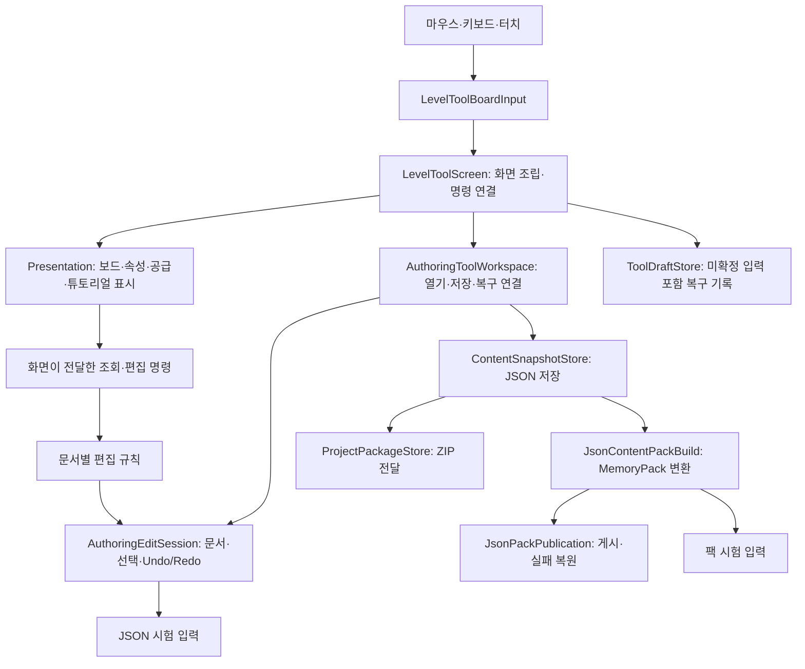

# 레벨툴 구조와 확장 위치

2026-10-19, 리팩토링 4단계 조사 기준. 검증 진행 상태와 제한은 [검증 기록](../../Verification/MoonRabbitJunkyard/2026-10-19-level-tool-refactor-stage04.md)을 따른다.

## 전체 흐름

화면에서 파일을 직접 바꾸는 대신, 편집 세션에서 변경과 Undo를 기록하고 저장 서비스로 반영한다. 패널은 화면 전체 객체를 받지 않으며 필요한 명령과 조회만 받는다. 이는 MVVM 프레임워크를 새로 도입한 구조가 아니라 기존 편집 모델을 재사용한 책임 분리다.

## 폴더와 소유권

| 위치 | 담당 |
|---|---|
| `Assets/Scripts/Features/LevelTool/Runtime/LevelToolScreen*.cs` | 메뉴·탭·모달·파일 전송·복구·시험 연결, 화면 조립 |
| 같은 폴더의 `LevelToolBoardInput.cs` | 포인터 제스처·취소·입력 수명 |
| `LevelTool/Runtime/Presentation/` | 보드 이미지와 오버레이, 기본 속성, 공급, 튜토리얼·조건 UI |
| `LevelAuthoring/Editing/` | Workspace, Session, 기본 속성·미션·공급·흐름 등 JSON 편집 규칙 |
| `LevelAuthoring/Runtime/` | 임시 Unity 표시 모델, 튜토리얼 편집 연결, JSON/팩 시험 어댑터 |
| `LevelAuthoring/Storage/` | JSON·ZIP·복구 저장 |
| `LevelAuthoring/Editor/` | Unity 에디터의 원본 선택·변환·게시·등록 |
| `Tests/Editor/Features/LevelAuthoring/` | 외부 테스트 하네스로 연결하는 회귀 검사 |

문서·선택·Undo/Redo의 소유자는 `AuthoringEditSession` 하나다. Workspace는 현재 폴더와 복구본 여부, 세션을 소유한다. Screen은 탭·도구·모달·공유 편집 사본과 표시용 상태를 소유한다. SupplyState/TutorialState는 입력 중 설정과 선택을 유지하지만 별도 문서나 Undo를 만들지 않는다.

공유 튜토리얼 편집 사본은 `SharedTutorialDraft`의 별도 세션에서 작업하고 명시적으로 적용한다. 일반 패널이 임의로 부모 세션을 교체하지 않는다. 보드 View는 이미지 요청·취소·아틀라스 수명을 소유한다.

## 생성·갱신·해제

1. Screen의 OnEnable에서 UI를 구성하고 보드 View와 패널을 생성한다. 세션 조회는 현재 Workspace를 바라보는 함수로 전달한다.
2. 입력은 기존 편집 명령을 호출한다. Session의 트랜잭션이 문서와 Undo를 갱신하고 Screen이 화면을 새로 표시한다.
3. 패널 Clear/Refresh는 세대 번호를 바꾼다. 이전 컨트롤의 콜백은 세션·레벨·세대가 맞지 않으면 문서를 수정하지 않는다.
4. 보드의 이전 비동기 이미지 결과도 수명과 세대를 검사한다. 레벨 전환 또는 Dispose 후 뒤늦은 결과를 적용하지 않는다.
5. OnDisable은 패널의 입력 필드를 지우기 전에 마지막 복구 기록을 저장한 뒤 입력·예약 작업·패널·이미지를 해제한다. OnDestroy도 남은 소유 자원을 해제한다. 재활성화 시 화면 객체는 다시 만들고 기존 Workspace의 편집 상태를 사용한다.

복구 저장은 문서 저장과 다르다. `ToolDraftStore`는 Workspace의 현재/저장 기준/Undo/Redo와 미확정 필드 문자열 등 화면 상태를 별도 기록한다. 이 기록을 읽었다고 정식 JSON을 덮어쓰지 않는다.

## 기능을 추가할 때

| 추가할 기능 | 시작 위치와 재사용 경계 |
|---|---|
| 기본 속성 필드 | `Presentation/LevelToolPropertiesPanel.cs`에 UI를 연결하고 `LevelAuthoring/Editing/`의 기존 속성 편집 규칙을 확장한다. 변경은 기존 Change→Session.EditLevel 트랜잭션을 사용한다. |
| 공급 설정 | `SupplyDocumentEditing.cs`에 검증/쓰기 규칙을 두고 `LevelToolSupplyPanel.cs`에 표시한다. 일반 공급과 튜토리얼 공급의 기존 EditTutorial 경계를 유지한다. |
| 튜토리얼 조건 | 기존 튜토리얼 조건 정의·평가 로직과 `LevelToolTutorialConditionsPanel.cs`의 편집 UI를 각각 확인한다. 대상 입력은 `LevelToolTutorialTargetFields`를 재사용하고 변경은 `TutorialDraftEditing`을 통해 독립 레벨/공유 사본에 적용한다. |
| 새 플랫폼 파일 선택 | 기존 LevelToolFileTransfer 경계를 사용한다. JSON/ZIP 편집 규칙을 플랫폼 구현에 복제하지 않는다. |

새 장애물의 게임 동작 등록과 레벨툴의 속성/조건 UI 등록은 별개다. UI를 추가했다고 게임 규칙이나 저장 스키마가 자동 확장되지는 않는다. 데이터 형식이 바뀌면 변환·검증·팩 호환성까지 함께 설계해야 한다.

예를 들어 이동 횟수 필드는 `LevelToolPropertiesPanel` → 화면의 Change → `Session.EditLevel` 내부의 `LevelDocumentEditing.SetMoveCount`로 이어진다. 공급 수량 필드는 `SupplyDocumentEditing.SetItemProperty`가 기존 항목 검증을 거쳐 교체한다. 튜토리얼 조건 횟수는 독립 단계의 값과 공유 흐름의 `TutorialFlowBinding.number`가 서로 다른 저장 대상이므로 기존 `TutorialDraftEditing.EditLevel`/공유 사본 적용 경로를 선택해야 한다. 패널에서 JSON 파일을 직접 저장하거나 별도 Undo 스택을 만들지 않는다.

## 의도적으로 남긴 경계

Screen에는 전체 화면 조정, 흐름·연결·모양 등 일부 UI가 남아 있다. 모든 partial 파일을 독립 클래스로 나눈 것은 아니다. 실제 변경 이유가 있을 때 책임 단위로 분리하고 범용 인터페이스를 미리 늘리지 않는다.

복구 기록은 각 Undo 상태에 문서 스냅샷을 포함하며 저장/읽기 검증 중 재구성한다. 대량 이력의 시간·메모리 비용은 별도 측정 대상이다. UI 검사 종료 성공을 복구 성능 해결로 해석하지 않는다.

4단계 측정에서 실제 38문서 프로젝트의 10회 편집은 약 26.4MB의 상태 문자열을 만들고 저장에 약 18.6초가 걸렸다. 읽기 중 전체 30초 보호 한도에 도달했으며 당시 Unity 작업 메모리는 약 7.33GB였다. 이 수치는 한 환경의 관측값이며 전체가 복구 기능만의 할당량이라는 의미는 아니다. 30/60회 표본은 실행하지 않았다. 문서 2개인 소형 표본에서는 전체 복원과 Undo/Redo 동일성을 확인했다.

권장 후속 범위는 공유 가능한 불변 문서 사본, 변경 문서만의 이력 보관, 중복 복구 검증의 비용을 비교하는 것이다. 저장 형식·Undo 의미·손상 기록 복원·원자적 저장 보호를 먼저 고정한 별도 계획이 필요하며, 이번 단계에서 이력을 제한하거나 자동 복구를 제거하지 않았다.

## 복구 성능 개선 1단계의 소유권 경계

`ToolDraftStore.ReadPrepared/ReadPreviousPrepared`는 v1 기록을 검증하며 만든 작업공간을 `PreparedDraft` 내부에 보관한다. 화면은 복사된 View만 읽고, 복구를 확정하면 `ApplyTo`가 기존 Workspace 객체에 세션을 한 번 이동한다. 임시 소유자는 비워지므로 같은 결과를 두 번 적용할 수 없다. 실패하거나 취소한 읽기 결과를 전역 캐시에 보관하지 않는다. 기존 Read/ReadPrevious는 JObject 반환 계약을 유지한다.

저장 시 입력 의미를 먼저 검증하고, Flush(true)한 임시 파일의 실제 바이트가 그 입력의 직렬화 바이트와 같은지 확인한다. 동일 자료의 Workspace를 다시 구성하지 않지만 파일 기록 검사와 현재/previous 보호는 유지한다. 큰 v1 이력 자체의 사본/직렬화 비용은 아직 남아 있다.

관련 결과: [복구 성능 1단계 기록](../../Verification/MoonRabbitJunkyard/2026-10-19-level-tool-recovery-performance-stage01.md).
